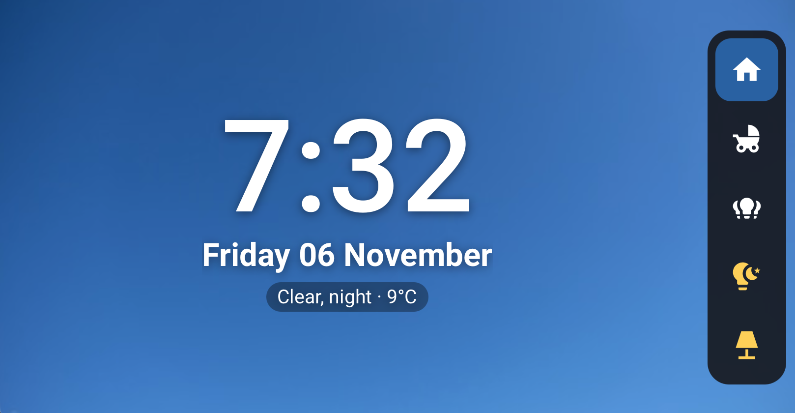
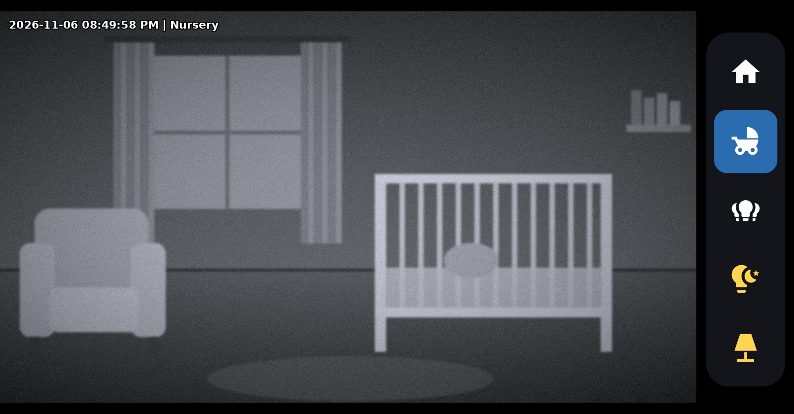
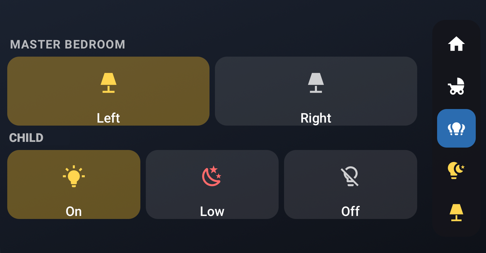

# Echo Show 5 Bedside Controller for Home Assistant

Turn a 2nd-gen Amazon Echo Show 5 into a bedside Home Assistant display: a big clock with the weather, one-tap light controls, and a baby monitor with sound from a UniFi Protect camera. It switches to a dim red night mode when the room goes dark.

This project was inspired by [The Stock Pot's video](https://youtu.be/6p5wvVl957c), which showed the build and the enclosure but didn't publish any code. This repo is the Home Assistant side: the dashboard, scripts and automations, plus the problems I hit and how I solved them.

| Home | Baby (mockup) | Lights |
|---|---|---|
|  |  |  |

*The Baby view image is a mockup. The camera picture is an illustration, not a real feed.*

## What you get

| View | What it shows |
|---|---|
| **Home** | Large clock, date and current weather over a background image |
| **Baby** | Full-height live camera with audio; tap the video for the mute button |
| **Lights** | Big tiles for the bedside lamps and On / Low (dim red) / Off for the nursery light |

A navigation rail on the right of every view has Home, Baby and Lights buttons, plus quick toggles for the nursery and bedroom lights.

**Night mode.** When the Echo's light sensor reads 5 lux or less, every view switches to a dim red palette that won't light up the room.

**The baby monitor stays open.** View Assist normally goes back to its default view after a timeout. An automation sends the Echo back to the camera while the monitor is "on".

## Hardware

- Amazon Echo Show 5, **2nd gen** (model C76N8S), jailbroken and running **LineageOS** (TWRP kept)
- The enclosure from The Stock Pot's video
- A camera in Home Assistant. I used a UniFi Protect camera, but any `camera.*` entity should work.
- *Optional:* [Amazon Ethernet Adapter for Fire TV devices](https://www.amazon.com/dp/B074TC662N) (micro-USB) to put the Echo on wired Ethernet. See [Wired Ethernet instead of Wi-Fi](#wired-ethernet-instead-of-wi-fi).

> **Jailbreak and LineageOS.** I followed these two, for the **Echo Show 5 2nd gen (2021, codename "cronos")**:
>
> - [Video walkthrough of the jailbreak and the LineageOS install](https://youtu.be/cuPikKRJQ2I)
> - [XDA: Unlock / Root / TWRP / Unbrick Amazon Echo Show 5 2nd Gen (2021) – cronos](https://xdaforums.com/t/unlock-root-twrp-unbrick-amazon-echo-show-5-2nd-gen-2021-cronos.4772596/)
>
> ⚠️ These steps are for the **2nd gen only**. The 1st gen Echo Show 5 is different hardware and needs different instructions. Check your model before you start.

## Software on the Echo

- **[View Assist Companion App (VACA)](https://github.com/msp1974/ViewAssist_Companion_App)**, which shows the dashboard and exposes the Echo to Home Assistant (light sensor, screen brightness, media player, wake word and more)

## Home Assistant requirements

- **[View Assist](https://github.com/dinki/view_assist_integration)** integration ([docs](https://dinki.github.io/View-Assist/)), for `view_assist.navigate` and the `<viewassist-clock>` element
- **VACA** integration (comes with the companion app)
- Frontend cards from HACS / the Marketplace:
  - [button-card](https://github.com/custom-cards/button-card): used by this dashboard and required by View Assist
  - [card-mod](https://github.com/thomasloven/lovelace-card-mod): required by View Assist ([its prerequisites](https://dinki.github.io/View-Assist/docs/viewassist-setup/homeassistant-configuration/viewassist-configuration/dashboard-views/lovelace-prereqs))
  - [layout-card](https://github.com/thomasloven/lovelace-layout-card): required by View Assist
  - [Advanced Camera Card](https://github.com/dermotduffy/advanced-camera-card): the Baby view
- Tested on Home Assistant 2026.11

## Setup

### 1. Create the helper

Settings → Devices & services → Helpers → Create helper → **Toggle**

- Name: `Bedside monitor`
- Entity ID: `input_boolean.bedside_monitor`

The scripts and the "keep baby monitor open" automation use it.

### 2. Map the entities

Every entity ID in this repo is a placeholder. Search and replace them with your own:

| Placeholder | What it is |
|---|---|
| `sensor.bedside_echo_light_level` | The Echo's light-level sensor (VACA). Drives night mode. |
| `sensor.bedside_echo` | The Echo's View Assist satellite sensor, used for navigation |
| `weather.home` | Any weather entity |
| `camera.nursery` | The camera for the Baby view |
| `light.nursery` | Nursery light (rail toggle and On / Low / Off) |
| `light.bedroom` | Main bedroom light (rail toggle) |
| `light.bedside_left`, `light.bedside_right` | Bedside lamps |

### 3. Add the dashboard

1. Settings → Dashboards → **Add dashboard** → "New dashboard from scratch". Give it the URL `dashboard-bedside`, or change the paths in the scripts and automations to match.
2. Open it → ⋮ → Edit dashboard → ⋮ → **Raw configuration editor**.
3. Paste in [`dashboard/bedside-dashboard.yaml`](dashboard/bedside-dashboard.yaml) and save.

### 4. Add the scripts and automations

- [`scripts.yaml`](scripts.yaml): `bedside_home`, `bedside_baby` and `bedside_lights`, used by the rail buttons
- [`automations.yaml`](automations.yaml): keeps the baby monitor open

### 5. Point VACA at the dashboard

Set the Echo's default dashboard/view in View Assist to `/dashboard-bedside/home`.

### Screen brightness

You don't need an automation for this. Leave VACA's **Auto brightness** on (in the app, or its switch entity in Home Assistant). It follows the Echo's light sensor and dims the screen well on its own. Night mode only changes the dashboard's colours, not the screen brightness, so the two work together.

## Lessons learned (the useful part)

### The dashboard couldn't be edited anymore

The `page` template uses `position: fixed` to fill the whole screen and hide Home Assistant's header and sidebar. That also covers the dashboard editor. The fix is to make it switch on the URL:

```yaml
- position: "[[[ return window.location.search.includes('edit=1') ? 'relative' : 'fixed'; ]]]"
```

Open `/dashboard-bedside/home?edit=1` on a computer to edit. The Echo never uses that parameter, so it always gets full screen.

### Baby monitor audio played 1 second out of every 7

This one took the longest. The video was smooth, but the sound came through in short bursts. Switching players (WebRTC vs Home Assistant's own player), switching streams (low vs medium) and even playing the stream on the Echo's native media player all gave the same 7-second cycle.

**Cause: the VACA wake word.** It keeps the microphone open, and on the Echo that keeps interrupting media audio. Setting the wake word to **None** (VACA's `Wake word` select entity, or in the app) fixed it right away. I don't use voice on this device, so I left it off. If you want voice, pause the wake word while `input_boolean.bedside_monitor` is on and restore it when it turns off.

### Which camera player and stream

- `live_provider: ha` (Home Assistant's own player) worked much better on the Echo than the WebRTC card.
- Once the wake word was off, the medium-resolution stream ran fine. UniFi Protect also offers a low-resolution channel to fall back on (it may be disabled by default in HA).

### Grey bar over the video

Advanced Camera Card's `menu.style: overlay` draws a grey bar over the video even when only the mute button is enabled, and overriding the background colour didn't work for me. `menu.style: hidden` leaves the video clean, and tapping the video brings up the mute button.

### Filling the screen

The Echo Show 5 is 960×480. Sizing the camera to the full height at 16:9 and pinning it to the left fills the space next to the rail:

```yaml
cam:
  - width: calc(100vh * 16 / 9)
  - max-width: 100%
  - justify-self: start
```

### Wired Ethernet instead of Wi-Fi

Our Wi-Fi is unreliable, and an always-on camera stream makes that obvious. I put the Echo on wired Ethernet with Amazon's [micro-USB Ethernet adapter for Fire TV devices](https://www.amazon.com/dp/B074TC662N), and it's been more stable since. Your mileage may vary: if your Wi-Fi is solid, you may not need it.

## Credits

- [The Stock Pot](https://youtu.be/6p5wvVl957c) for the original idea and the enclosure
- The View Assist and VACA developers
- The authors of button-card and Advanced Camera Card

## License

[MIT](LICENSE). Use it, change it and share it; just keep the copyright notice.
